# UniAttend: A Web-Based University Attendance Management System

**Final Capstone Project, Part I: Proposal and Prototype**

| Student | Student ID | Course | Instructor | Session |
|---|---|---|---|---|
| Pritom Kumar Sen Anom | IT24061 | Software Engineering and Project Management (ICT3107) | Dr. Ziaur Rahman | 2023-2024 |

Department of ICT, Mawlana Bhashani Science and Technology University (MBSTU)

PDF (LaTeX) version: [UniAttend_Proposal.pdf](UniAttend_Proposal.pdf)

Interactive prototype: open [`frontend/index.html`](../frontend/index.html) in a browser.

## 1. Abstract

Most universities still record class attendance on paper sheets. Sheets get lost, totals are calculated by hand, students cannot check their own record, and corrections leave no trace. UniAttend replaces the paper sheet with a centralized web application where teachers record attendance per class, students monitor their own percentage, and administrators manage courses and departmental reports. Every class and every correction is stored permanently.

## 2. Problem Statement and Objectives

Manual attendance causes slow reporting, calculation errors, proxy marking, no audit trail and no early warning for students at risk. The objectives are:

- Let teachers take attendance for a class in under one minute.
- Calculate attendance percentage automatically and correctly.
- Give each student a private view of their own record and warnings.
- Keep a permanent history of every class and every correction.
- Give administrators department-level reports.

## 3. Scope

| In scope (version 1) | Out of scope (future work) |
| --- | --- |
| Teacher attendance taking, history, correction, report, CSV export Student dashboard with percentage and low-attendance warning Admin account and course management Class duration of 1 to 5 hours; one Present or Absent mark per class counts for every hour of it Course join link: students join with their university email and a nickname, ID and full name saved automatically; the teacher sees nickname and ID Role-based access and audit log | Biometric or face recognition Mobile native app Exam eligibility decisions (the university policy decides, not the software) Integration with the university ERP |

## 4. Stakeholders and Users

| User | Main needs |
| --- | --- |
| Teacher | Fast attendance entry, history, safe correction, reports |
| Student | View own attendance, dates present or absent, warnings |
| Administrator | Manage users and courses, view department reports |

## 5. Requirements

### Functional

| ID | Requirement |
| --- | --- |
| FR1 | Every teacher, student and admin has an individual account (university email as login ID and a password) and, after signing in, sees only their own dashboard. |
| FR2 | A teacher records Present or Absent for every enrolled student of their own course for a given date, one mark per student for the class. |
| FR3 | The system rejects future dates and a second class on the same date for the same course. |
| FR4 | A teacher can correct a record only with a reason; the change is stored in an audit log. |
| FR5 | Attendance percentage = attended hours / held hours × 100, counting only held classes and only hours the student was enrolled for; shows N/A when none held. |
| FR6 | A student sees per-course hour totals, a timeline of classes (date, hours, Present or Absent) that can be filtered to Present, Absent or All classes, and a warning below the configurable minimum (default 60%). |
| FR7 | A teacher exports a course report as CSV. |
| FR8 | An admin creates teacher and student accounts, courses, enrollments and assigns teachers. |
| FR9 | A teacher generates a course join link (random code, expires in 7 days, can be replaced by a new one). |
| FR10 | A student opens the link and signs in with the university email; the student chooses a nickname, the full name comes from the university account, the ID from the email (it24061@mbstu.ac.bd gives ID IT24061), and the student is enrolled automatically with no manual entry by the teacher. |
| FR11 | The system rejects expired or invalid links, emails outside the university domain, emails missing from the university directory, duplicate joins and nicknames already used in the course; one university email maps to one student. |
| FR12 | A teacher sets the class duration (1 to 5 hours) when taking attendance; each student gets one Present or Absent mark for the class, and it counts for every hour of that class (a 2-hour class gives 2 present hours or 2 absent hours). |
| FR13 | The attendance sheet shows each student's nickname and ID; clicking the ID shows the full name, university email, nickname and attendance summary. |
| FR14 | A nickname has 2 to 20 characters and is unique within a course. |
| FR15 | Passwords are stored only as salted hashes in the database (users table). A password needs at least 8 characters with a letter and a number, and 5 wrong attempts lock the account for a minute. |
| FR16 | Forgot password: the user enters the university email, receives a 6-digit reset code (valid 10 minutes, limited tries, single use) and sets a new password. The reply never reveals whether an email is registered. |
| FR17 | Student IDs are always listed in order, newest batch first and then by number (IT24001, IT24002, ..., IT23001, ...), whatever order students join. The ID is added automatically from the university email, so nobody types it. |
| FR18 | On a desktop browser the teacher can take attendance with the keyboard: W or Up arrow and S or Down arrow move the highlighted row, and Enter switches Present and Absent. The active row is highlighted automatically. Phones and tablets use touch. |
| FR19 | The admin manages a university directory (email and full name). A student can join a course only if the email is in the directory, and the full name is taken from it. In the real system the directory is replaced by the university account (OAuth sign-in). |

### Non-functional

- **Security:** passwords stored only as salted hashes (bcrypt in the real system), account lockout after wrong attempts, password reset by a one-time emailed code, role-based authorization, students cannot edit records.
- **Reliability:** data stored in a relational database with regular backup.
- **Usability:** a 50-student sheet can be completed in under one minute; works on phone screens.
- **Performance:** a page loads in under 3 seconds for 500 concurrent users.

## 6. Technology Stack

| Layer | Choice |
| --- | --- |
| Frontend | HTML, CSS, JavaScript |
| Backend | Java, Spring Boot, Spring Security (email and password login with bcrypt hashes; optional OAuth2 sign-in with the university account) |
| Database | MySQL with Spring Data JPA |
| Tools | Git and GitHub, JUnit, Mermaid and LaTeX for documents |

## 7. Software Process Model: Incremental Model

The Incremental model fits this project because the core idea (take attendance, keep history, let students view it) can be delivered first and working, and later features are added in further increments. Each increment passes through requirements, design, implementation and testing, so risk is found early and the course deadline is protected.

| Increment | Content | Output |
| --- | --- | --- |
| 1 | Proposal, requirements, UML design | This document |
| 2 | Interface prototype (8 classes) | Working demo |
| 3 | Backend, database, authentication, roles | Working system |
| 4 | Testing, fixes, documentation, deployment | Released website |

## 8. Schedule, Milestones and Deliverables

| Milestone | Date | Deliverable |
| --- | --- | --- |
| M1 Proposal approved | 27 Oct 2026 | Proposal, requirements, six UML diagrams, Gantt chart |
| M2 Prototype ready | 27 Oct 2026 | Interactive interface using 8 classes |
| M3 Backend and database done | 29 Nov 2026 | REST API, MySQL schema, login, roles |
| M4 Integration complete | 6 Dec 2026 | Frontend connected to backend |
| M5 Testing complete | 13 Dec 2026 | Test report, bug fixes |
| M6 Final release | 20 Dec 2026 | Deployed site, final report, source on GitHub |

### Gantt Chart

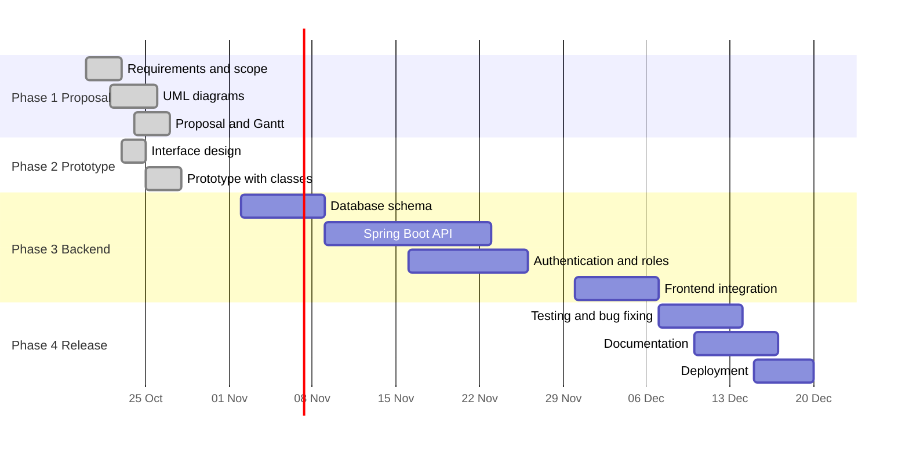

## 9. Risk Analysis

| Risk | Likelihood | Mitigation |
| --- | --- | --- |
| Learning Spring Boot takes longer | Medium | Prototype first; build backend in small increments |
| Scope grows | High | Version 1 limited to attendance, history, student view |
| Data loss | Low | Database backups, Git for code |
| Unauthorized edits | Medium | Role checks on the server, audit log |

## 10. Testing Plan

Unit tests (JUnit) for percentage calculation, duplicate-date rule, future-date rule and permission checks. Integration tests for login and attendance save. User acceptance testing with one teacher and a few students. Example case: 20 attended hours out of 25 held hours must display 80%. The prototype also has automated rule tests (`frontend/tests/models.test.js`, 26 tests) for duration limits, percentage weighted by class hours, corrections, join rules, ID sorting, login, password rules and password reset.

## 11. UML Diagrams

### 11.1 Data Flow Diagram (Level 0)

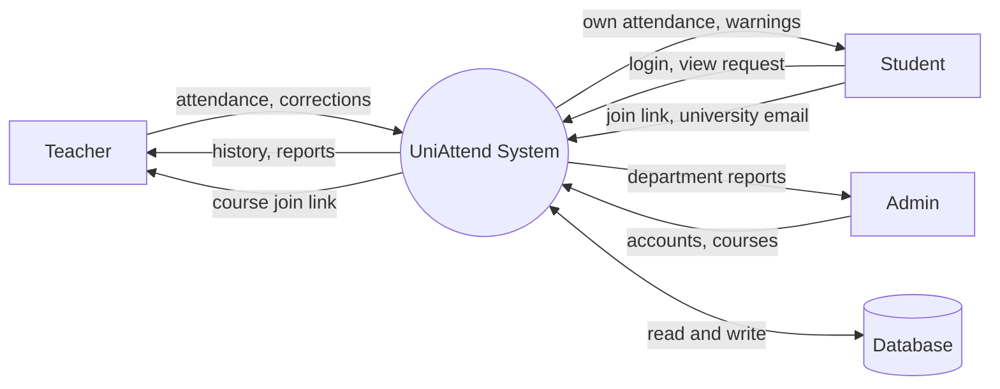

### 11.2 Use Case Diagram

*Editable source: [usecase.puml](diagrams/usecase.puml) (PlantUML)*

### 11.3 Activity Diagram (Take Attendance)

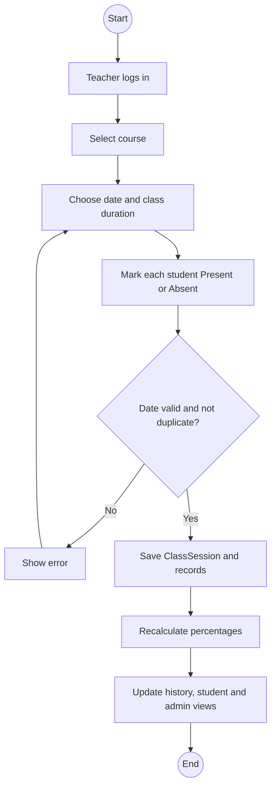

### 11.4 Entity Relationship Diagram

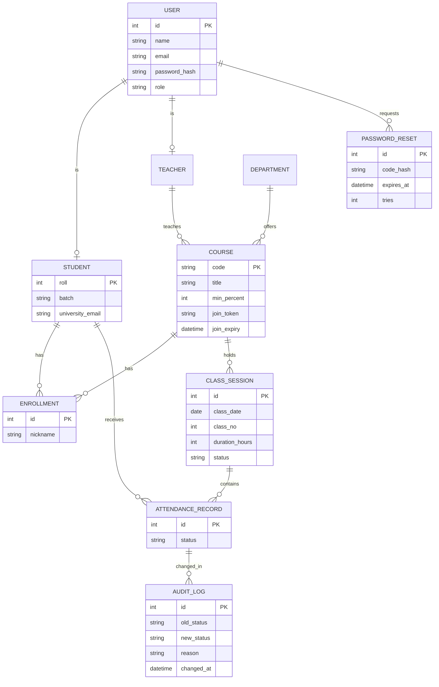

### 11.5 Class Diagram

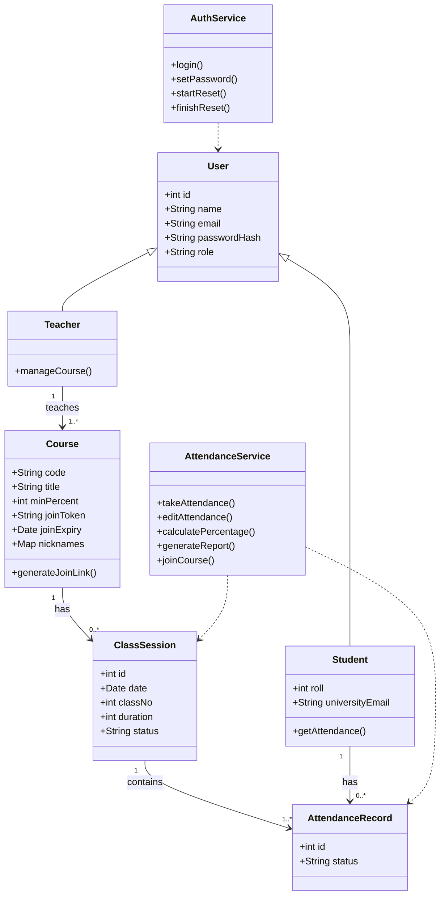

### 11.6 Object Diagram

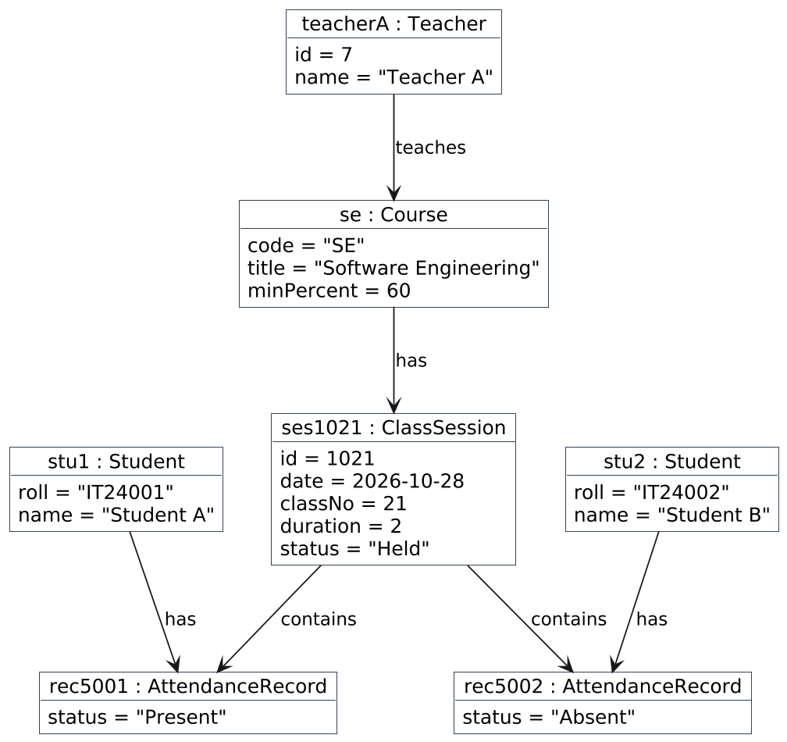

*Editable source: [object.puml](diagrams/object.puml) (PlantUML)*

### 11.7 Activity Diagram (Join Course by Link)

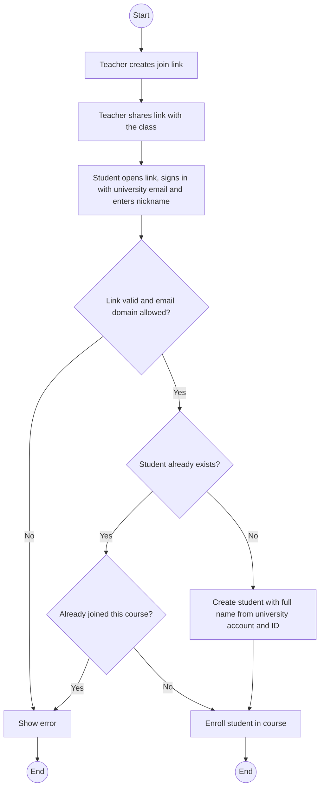

### 11.8 Data Flow Diagram (Level 1)

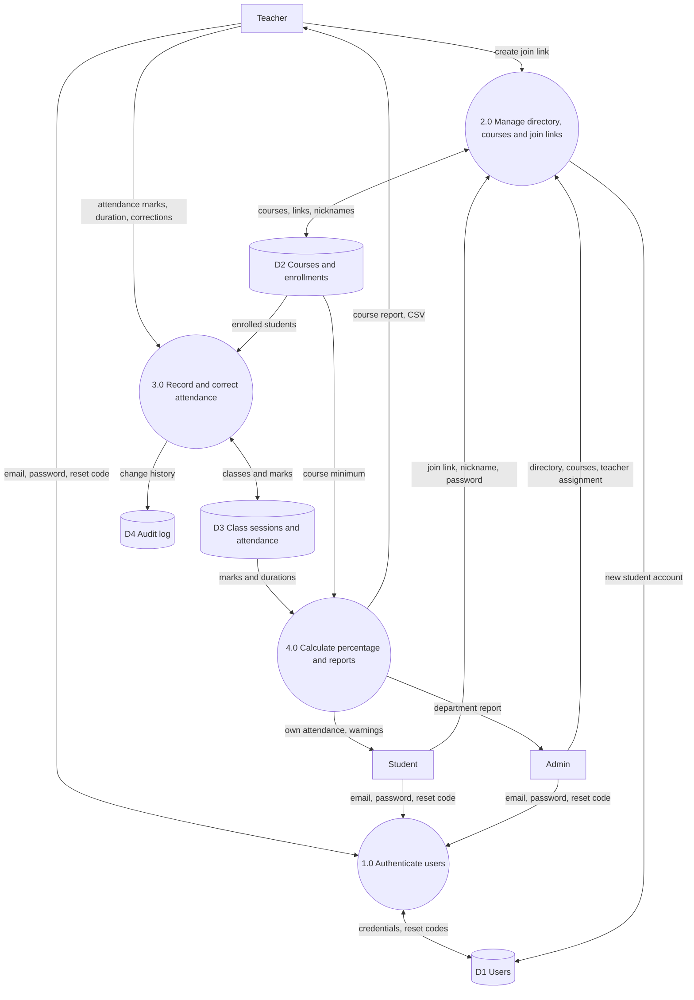

## 12. Interface Prototype

The prototype implements eight classes from the class diagram in JavaScript (with email and password login, forgot password, class duration of 1 to 5 hours counted as hours, keyboard attendance on desktop, sorted student IDs, a student timeline of hour squares, nicknames, and the full name collected automatically from the university account): `User`, `Student`, `Teacher`, `Course`, `ClassSession`, `AttendanceRecord`, `AttendanceService` and `AuthService`. It demonstrates taking attendance, history, correction with an audit log, the percentage rule, the student warning and the admin report. [Open the prototype](../frontend/index.html). Prototype data is saved in the browser's localStorage only (it works across tabs of one browser, and is not a database); the full system stores it in MySQL.

### Prototype Screenshots

| Screen | Image |
|---|---|
| Sign in with university email and password (demo accounts, forgot password link, join by link) |  |
| Teacher takes attendance with the keyboard: highlighted row, duration selector, nickname and ID, one mark per student | 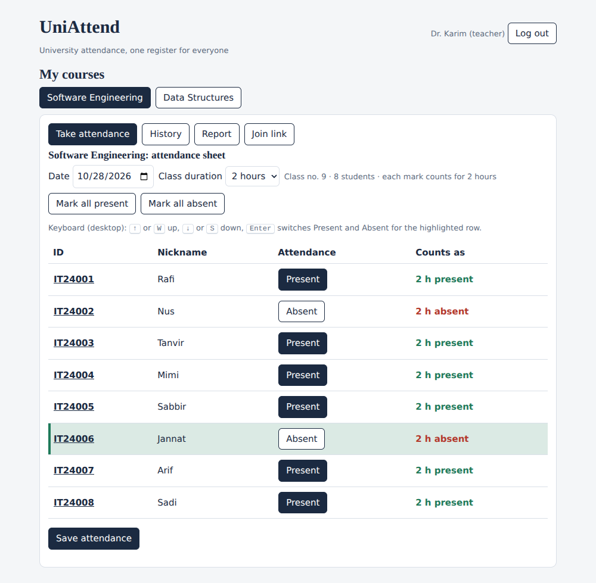 |
| Click an ID to see full name and details |  |
| History, correction with reason and audit log | 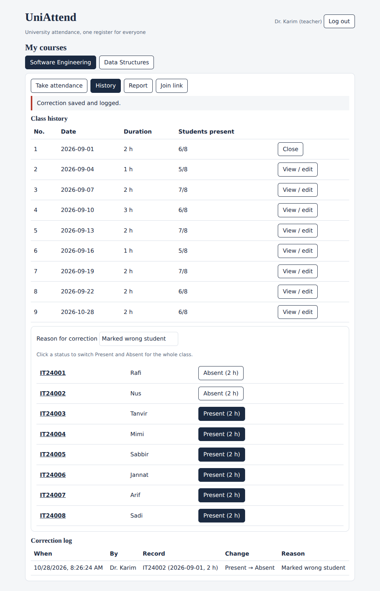 |
| Teacher report in hours with low attendance flag | 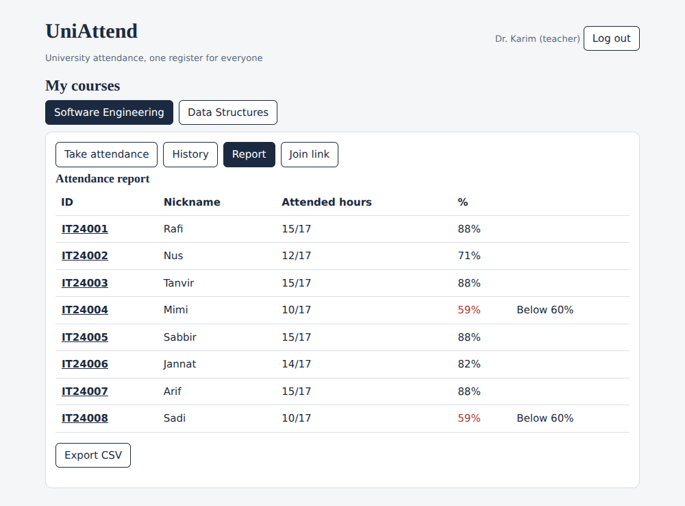 |
| Teacher creates a course join link |  |
| Student joins with university email and nickname |  |
| New student appears on the sheet with nickname and ID | 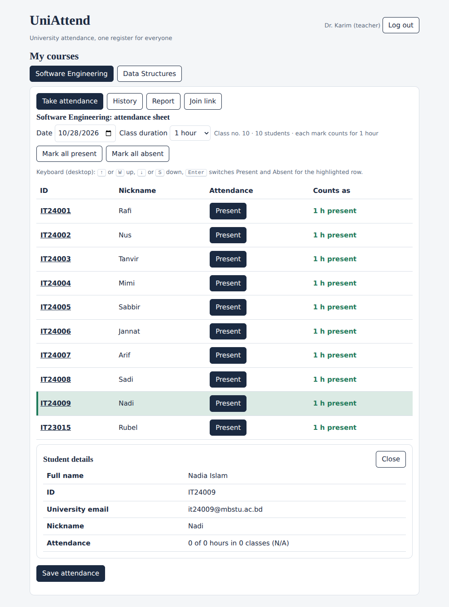 |
| Student dashboard: hour tiles, class timeline with hour squares and Present / Absent / All filters |  |
| Admin department report and university directory |  |
| Forgot password: reset code and new password |  |

## 13. Feasibility Study

| Area | Finding |
|---|---|
| Technical | The stack (HTML, CSS, JavaScript, Java with Spring Boot, MySQL) is mature, free and well documented. The core rules (hour-weighted percentage, corrections, join link, login) are already working in the prototype and covered by 26 automated tests. The main technical risks are learning Spring Boot and Spring Security and integrating university sign-in. Both are reduced by building in small increments and by keeping email and password login as the first version. |
| Economic | Development tools (VS Code or IntelliJ Community, Git, GitHub, MySQL Community, Mermaid, PlantUML, LaTeX) are free. The only running cost is hosting for the backend and database: a university server or a low-cost cloud plan (assumed budget of up to BDT 2,000 per month after deployment, to be confirmed). The benefit is saved teacher time, fewer calculation errors and a record students can trust. |
| Operational | Teachers already take attendance every class, so the new steps are small: pick duration, mark students, save. The join link removes manual entry of student IDs and names. Students only sign in and read. Keyboard shortcuts speed up large classes on desktop. |
| Schedule | About 8.5 weeks are planned (20 Oct to 20 Dec 2026) with an incremental model. Version 1 is limited to attendance, history, student view, login and the join link, so the plan fits one developer. |
| Legal and privacy | The system stores student names, IDs, emails and attendance. Passwords are stored only as salted hashes, access is role-based, and every correction is logged. The system must follow the university's data protection and privacy rules, and exam eligibility stays a university decision. |

**Conclusion:** the project is technically, economically, operationally and schedule-wise feasible for version 1.

## 14. Effort and Cost Estimate

| Work item | Estimated effort (hours) |
|---|---|
| Requirements and scope | 12 |
| UML diagrams, proposal and Gantt chart | 24 |
| Interface prototype and tests | 30 |
| Database schema | 12 |
| Spring Boot API | 50 |
| Authentication and roles | 24 |
| Frontend integration | 24 |
| Testing and bug fixing | 24 |
| Documentation | 16 |
| Deployment | 10 |
| Project management and reviews | 10 |
| **Total** | **236** |

236 hours over about 8.5 weeks is roughly 27 hours per week for one developer. As an illustration only, at an assumed rate of BDT 300 per hour the effort is worth about BDT 70,800. Tools cost nothing, and hosting is the only cash cost (see the feasibility study). These are planning estimates and will be revised after each increment.

## 15. Assumptions, Constraints and Dependencies

**Assumptions**

- Every student, teacher and admin has a university email address.
- Classes last 1 to 5 whole hours and the default minimum attendance is 60%, configurable per course.
- Users have a modern desktop or mobile browser and internet access.
- Teachers use a desktop computer for the keyboard shortcuts; phones use touch.

**Constraints**

- One developer, fixed deadlines, free or low-cost tools.
- The software records attendance and calculates percentages only. The university policy decides exam eligibility.
- No integration with the university ERP in version 1.

**Dependencies**

- Access to the university account list or sign-in (the prototype simulates it with an admin-managed directory).
- A server or cloud account to host Spring Boot and MySQL.

## 16. Quality Assurance and Configuration Management

- **Version control:** Git and GitHub, small commits with clear messages, one branch per increment, merged only after the tests pass.
- **Testing:** unit tests for business rules (already automated), integration tests for the API, and user acceptance testing with a teacher and students.
- **Definition of done:** a feature is complete when it meets its requirement (FR numbers), has tests, passes them, and is documented in the README.
- **Change control:** requirement changes are recorded in the proposal and traced to tests and diagrams.
- **Security checks:** hashed passwords, lockout after wrong attempts, role checks on the server, no sensitive data in the repository.
- **Backups:** regular database backup after deployment.

## 17. Conclusion

UniAttend is a realistic and extendable project. Version 1 delivers the three most valuable features first, and later increments add the real backend, admin tools and reports. Future ideas include QR-based check-in, risk prediction for students near the minimum and excused-absence requests.

## 18. References

1. I. Sommerville, *Software Engineering*, 10th ed., Pearson, 2016.
2. R. S. Pressman and B. R. Maxim, *Software Engineering: A Practitioner's Approach*, 9th ed., McGraw-Hill, 2019.
3. M. Fowler, *UML Distilled*, 3rd ed., Addison-Wesley, 2003.
4. ISO/IEC/IEEE 29148:2018, *Systems and software engineering: Life cycle processes: Requirements engineering*.
5. Spring Boot and Spring Security documentation, <https://spring.io/projects/spring-boot>
6. MySQL Reference Manual, <https://dev.mysql.com/doc/>
7. OWASP, *Password Storage Cheat Sheet*, <https://cheatsheetseries.owasp.org/cheatsheets/Password_Storage_Cheat_Sheet.html>
8. Mermaid documentation, <https://mermaid.js.org>, and PlantUML documentation, <https://plantuml.com>
